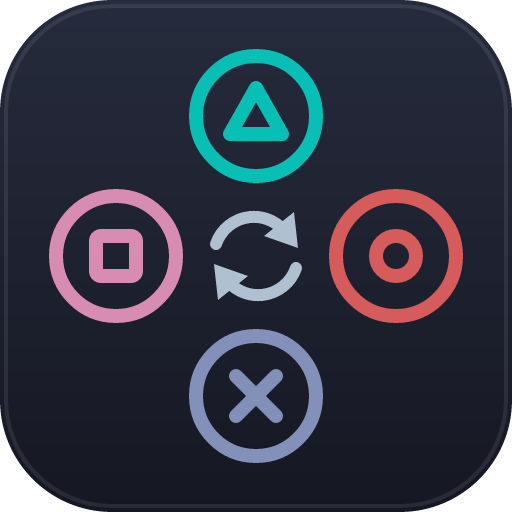
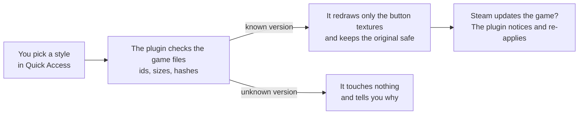

<p align="center">
  
</p>

<h1 align="center">Button Glyphs</h1>

<p align="center">
  <b>Choose PlayStation or Xbox button prompts for your games on the Steam Deck.</b><br>
  A <a href="https://github.com/SteamDeckHomebrew/decky-loader">Decky Loader</a> plugin. Per game. Reversible. Open source.
</p>

<p align="center">
  <a href="https://github.com/evertonfxavier/button-glyphs/actions/workflows/build-plugin.yml"></a>
  <a href="https://github.com/evertonfxavier/button-glyphs/releases/latest"></a>
  <a href="LICENSE"></a>
  
</p>

<p align="center"><b>English</b> · <a href="README.pt-BR.md">Português (Brasil)</a></p>

---

## What is this?

Many PC games show **Xbox-style** prompts ("press **A**") or their own symbols, even if you prefer PlayStation's
✕ ○ □ △. Button Glyphs changes those prompts **inside the game's files**, one game at a time, so you see the style you like.

> **Example.** *Assassin's Creed* (2008) draws a little body-part icon for every action. Choose **PlayStation** in the
> plugin and ✕ ○ □ △ appear instead; choose **Original** and the game is exactly as Steam installed it.

## Highlights

- **One dropdown per game:** Original, PlayStation or Xbox.
- **Your originals are safe.** *Original* restores the exact bytes Steam installed (checked by SHA-256 in the tests).
- **Survives game updates.** When Steam updates a game, or you "Verify integrity of game files", your choice is re-applied automatically.
- **Careful by design.** It checks the game files before touching them, refuses versions it does not recognise, and never changes a game while it runs.
- **Nothing to configure, no root, no internet.**

## Quick start

You need a Steam Deck with [Decky Loader](https://github.com/SteamDeckHomebrew/decky-loader) installed.

1. **Download** `button-glyphs-vX.Y.Z.zip` from the [latest release](https://github.com/evertonfxavier/button-glyphs/releases/latest) and get it onto the Deck
   (download it in Desktop Mode, or copy it over from your PC). A `.sha256` file sits next to it if you want to check the download.
2. **Turn on Decky's Developer Mode.** In Game Mode press the **Quick Access** button (**···**), open **Decky**, then the
   **⚙ Settings** page, and switch **Developer Mode** on. It only unlocks installing a plugin from a file.
3. **Install the plugin.** In Decky's settings open the **Developer** section and choose **Install Plugin from ZIP**, then pick the file.
4. **Use it.** Open **Button Glyphs** from Decky's plugin list, pick a game in the first dropdown, then pick a style.

That is all. Start the game and look at the prompts.

## Supported games

<!-- GAMES:START -->
| Game | Steam ID | Support | Details |
|------|----------|---------|---------|
| [Assassin's Creed](SUPPORTED_GAMES.md#assassins-creed-15100) | 15100 | 🟡 partly confirmed | [technical notes](docs/games/15100-assassins-creed.md) |
| [Charlie Murder](SUPPORTED_GAMES.md#charlie-murder-405290) | 405290 | ✅ confirmed | [technical notes](docs/games/405290-charlie-murder.md) |
| [Quantum Break](SUPPORTED_GAMES.md#quantum-break-474960) | 474960 | ⚪ unconfirmed | [technical notes](docs/games/474960-quantum-break.md) |
| [Saint Seiya: Soldiers' Soul](SUPPORTED_GAMES.md#saint-seiya-soldiers-soul-348710) | 348710 | ⚪ unconfirmed | [technical notes](docs/games/348710-saint-seiya.md) |
<!-- GAMES:END -->

Full details, what each game changes and how sure we are: **[SUPPORTED_GAMES.md](SUPPORTED_GAMES.md)**.
Every game stores its prompts differently, so each one needs its own *profile*. Yours is missing?
[Request it](https://github.com/evertonfxavier/button-glyphs/issues/new?template=game_request.yml) or
[add it yourself](docs/adding-a-game.md).

## Using it

Pick a game, pick a style, start the game. The line under the dropdown tells you what is going on:

| What you see | What it means |
|--------------|---------------|
| *PlayStation glyphs active* | Done. |
| *Game is running* | The change is applied as soon as you close the game. |
| *Steam is updating this game* | It will be applied after the update finishes. |
| *…will be applied* | Waiting for the next check (every minute, or press **Check for game updates now**). |
| *this game version is not supported yet* | An update changed the game in a way the plugin does not recognise. **Nothing was modified.** [Tell us](https://github.com/evertonfxavier/button-glyphs/issues/new?template=bug_report.yml). |

## Is it safe?

Short answer: it was built so that you can always go back. The longer answer is in the [FAQ](docs/faq.md#is-it-safe-for-my-games).

- **What it changes:** only button textures (or, for one game, a single byte of its program) in the game's own folder.
- **How you go back:** pick **Original**. Or in Steam: *game → Properties → Installed Files → Verify integrity of game files*.
- **Uninstalling the plugin:** first set every game to **Original**, then remove the plugin from Decky. If you forget, Steam's *Verify integrity* restores the files.
- **Online games:** the plugin only supports offline-friendly games, because changing files of games with anti-cheat can get an account banned. Check the game's notes in [SUPPORTED_GAMES.md](SUPPORTED_GAMES.md).
- **No game art is shipped.** The plugin draws its own icons.

## Something went wrong?

1. Read the [FAQ and troubleshooting](docs/faq.md).
2. Still stuck? [Open a bug report](https://github.com/evertonfxavier/button-glyphs/issues/new?template=bug_report.yml). The form tells you which log to attach (`~/homebrew/logs/Button Glyphs/`).
3. Played a game with the plugin? [Tell us how it looked](https://github.com/evertonfxavier/button-glyphs/issues/new?template=in_game_report.yml): it is the most valuable thing you can do, because nobody can verify a visual change without seeing the game.

## How it works



- Every game gets a **profile** that knows where *that* game keeps its prompts. There are a few strategies (rewrite textures in an archive, rewrite them in place inside a huge file, flip one switch in the game's code).
- Every file the plugin writes carries a small **marker**, so after an update it knows whether the file is original or ours, and *Original* is exact.
- The icons are drawn from our own icon set ([`assets/svg`](assets/svg)).

Want the engineering view? Read [docs/architecture.md](docs/architecture.md).

## Contributing

**You do not need to be a programmer to help.** The project is young and every game is a new puzzle.

| I want to… | Effort | Start here |
|------------|--------|------------|
| Tell whether a game looks right | 5 min | [In-game report](https://github.com/evertonfxavier/button-glyphs/issues/new?template=in_game_report.yml) |
| Ask for a game | 5 min | [Game request](https://github.com/evertonfxavier/button-glyphs/issues/new?template=game_request.yml) |
| Fix a typo, improve the docs, translate | 15 min | [CONTRIBUTING.md](CONTRIBUTING.md) |
| Add or fix icons | 1 h | [CONTRIBUTING.md](CONTRIBUTING.md#add-or-fix-icons) |
| Add support for a game | a few hours | [docs/adding-a-game.md](docs/adding-a-game.md) |
| Improve the engine or the UI | varies | [docs/development.md](docs/development.md) |

Everyone is expected to follow the [Code of Conduct](CODE_OF_CONDUCT.md). Found a security problem? See [SECURITY.md](SECURITY.md).

## Build from source

```bash
pnpm install
pnpm test             # backend tests (they never need game files)
pnpm run build:zip    # out/button-glyphs-vX.Y.Z.zip
```

Requirements: Node.js 20+, pnpm 9+, Python 3.9+. More in [docs/development.md](docs/development.md).
Releases are published automatically when the version in `package.json` changes on `main`.

## Credits and legal

- **Icons:** PlayStation and Xbox style icons come from the Figma community files *PlayStation Controller Icons* and *Xbox Controller Icons Free*. The project logo is original.
- **Fonts:** relabelled shoulder buttons use Montserrat Bold (SIL Open Font License).
- **Template:** based on the [decky-plugin-template](https://github.com/SteamDeckHomebrew/decky-plugin-template).
- **Trademarks:** PlayStation, Xbox, Steam and the game titles belong to their owners. This is an unofficial community project, not affiliated with or endorsed by Sony, Microsoft, Valve, or any game publisher.
- **Game files:** the plugin ships no game assets; it edits the copy of the game you already own.

## License

[BSD 3-Clause](LICENSE).
