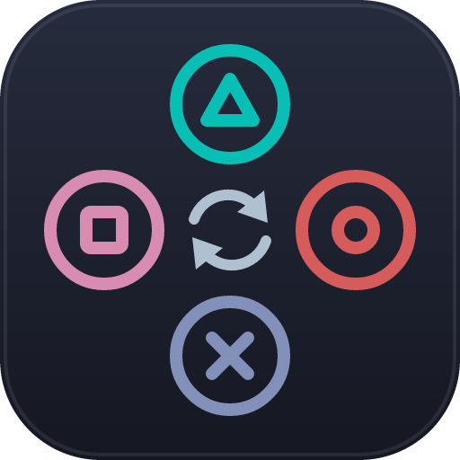
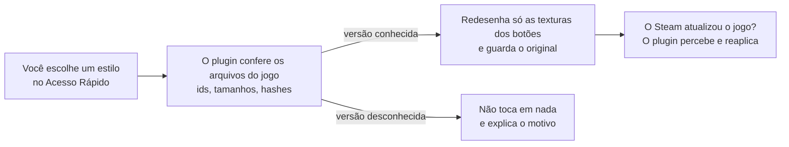

<p align="center">
  
</p>

<h1 align="center">Button Glyphs</h1>

<p align="center">
  <b>Escolha os botões do PlayStation ou do Xbox nos seus jogos do Steam Deck.</b><br>
  Um plugin do <a href="https://github.com/SteamDeckHomebrew/decky-loader">Decky Loader</a>. Jogo a jogo. Reversível. Código aberto.
</p>

<p align="center">
  <a href="https://github.com/evertonfxavier/button-glyphs/actions/workflows/build-plugin.yml"></a>
  <a href="https://github.com/evertonfxavier/button-glyphs/releases/latest"></a>
  <a href="LICENSE"></a>
  
</p>

<p align="center"><a href="README.md">English</a> · <b>Português (Brasil)</b></p>

> A documentação técnica (`docs/`) e os guias de contribuição estão em inglês. Este README e o [FAQ](docs/faq.md) cobrem o que quem usa precisa saber.

---

## O que é isso?

Muitos jogos de PC mostram botões no estilo **Xbox** ("aperte **A**") ou símbolos próprios, mesmo que você prefira os
✕ ○ □ △ do PlayStation. O Button Glyphs troca esses botões **dentro dos arquivos do jogo**, um jogo por vez, para você
ver o estilo que gosta.

> **Exemplo.** *Assassin's Creed* (2008) desenha um ícone de parte do corpo para cada ação. Escolha **PlayStation** no
> plugin e aparecem ✕ ○ □ △ no lugar; escolha **Original** e o jogo fica exatamente como o Steam instalou.

## Destaques

- **Um menu por jogo:** Original, PlayStation ou Xbox.
- **Seus originais ficam protegidos.** *Original* devolve exatamente os mesmos bytes que o Steam instalou (conferido por SHA-256 nos testes).
- **Sobrevive a atualizações.** Se o Steam atualizar o jogo, ou você usar "Verificar integridade dos arquivos", a sua escolha é reaplicada sozinha.
- **Cuidadoso.** Confere os arquivos antes de mexer, recusa versões que não reconhece e nunca altera um jogo enquanto ele está aberto.
- **Nada para configurar, sem root, sem internet.**

## Começando

Você precisa de um Steam Deck com o [Decky Loader](https://github.com/SteamDeckHomebrew/decky-loader) instalado.

1. **Baixe** o `button-glyphs-vX.Y.Z.zip` da [última versão](https://github.com/evertonfxavier/button-glyphs/releases/latest) e leve para o Deck
   (baixe no Modo Desktop, ou copie do seu PC). Ao lado há um arquivo `.sha256` para conferir o download.
2. **Ligue o Modo Desenvolvedor do Decky.** No Modo Jogo aperte o botão de **Acesso Rápido** (**···**), abra o **Decky**, depois a
   página de **⚙ Configurações** e ative **Developer Mode**. Isso só libera instalar um plugin a partir de um arquivo.
3. **Instale o plugin.** Nas configurações do Decky abra a seção **Developer** e escolha **Install Plugin from ZIP**, depois selecione o arquivo.
4. **Use.** Abra o **Button Glyphs** na lista de plugins do Decky, escolha um jogo no primeiro menu e depois o estilo.

Só isso. Abra o jogo e olhe os botões.

## Jogos suportados

A lista de jogos, o que cada um muda e o quanto temos certeza fica em **[SUPPORTED_GAMES.md](SUPPORTED_GAMES.md)**
(em inglês; é gerada a partir do código, então está sempre em dia).

Cada jogo guarda os botões de um jeito, então cada um precisa do seu próprio *perfil*. Falta o seu?
[Peça aqui](https://github.com/evertonfxavier/button-glyphs/issues/new?template=game_request.yml) ou
[adicione você mesmo](docs/adding-a-game.md).

## Como usar

Escolha o jogo, escolha o estilo, abra o jogo. A linha abaixo do menu diz o que está acontecendo:

| O que aparece | O que significa |
|---------------|-----------------|
| *PlayStation glyphs active* | Pronto. |
| *Game is running* | A mudança é aplicada assim que você fechar o jogo. |
| *Steam is updating this game* | Será aplicada quando a atualização terminar. |
| *…will be applied* | Esperando a próxima checagem (a cada minuto, ou aperte **Check for game updates now**). |
| *this game version is not supported yet* | Uma atualização mudou o jogo de um jeito que o plugin não reconhece. **Nada foi modificado.** [Avise-nos](https://github.com/evertonfxavier/button-glyphs/issues/new?template=bug_report.yml). |

## É seguro?

Resposta curta: foi feito para você sempre poder voltar atrás. A resposta longa está no [FAQ](docs/faq.md#is-it-safe-for-my-games).

- **O que muda:** só texturas de botões (ou, em um jogo, um único byte do programa) na pasta do próprio jogo.
- **Como voltar:** escolha **Original**. Ou, no Steam: *jogo → Propriedades → Arquivos instalados → Verificar integridade dos arquivos*.
- **Desinstalar o plugin:** primeiro coloque todos os jogos em **Original**, depois remova o plugin no Decky. Se esquecer, a *Verificação de integridade* do Steam restaura os arquivos.
- **Jogos online:** o plugin só suporta jogos que funcionam bem offline, porque alterar arquivos de jogos com anti-cheat pode banir a conta. Veja as notas de cada jogo em [SUPPORTED_GAMES.md](SUPPORTED_GAMES.md).
- **Nenhuma arte de jogo é distribuída.** O plugin desenha os próprios ícones.

## Algo deu errado?

1. Leia o [FAQ e solução de problemas](docs/faq.md).
2. Ainda travado? [Abra um relato de erro](https://github.com/evertonfxavier/button-glyphs/issues/new?template=bug_report.yml). O formulário diz qual log anexar (`~/homebrew/logs/Button Glyphs/`).
3. Jogou algo com o plugin? [Conte como ficou](https://github.com/evertonfxavier/button-glyphs/issues/new?template=in_game_report.yml): é a ajuda mais valiosa, porque ninguém consegue verificar uma mudança visual sem ver o jogo.

## Como funciona



- Cada jogo tem um **perfil** que sabe onde *aquele* jogo guarda os botões. Há poucas estratégias (reescrever texturas num arquivo, reescrever no lugar dentro de um arquivo enorme, virar uma chave no código do jogo).
- Todo arquivo que o plugin escreve leva uma pequena **marca**; assim, depois de uma atualização, ele sabe se o arquivo é original ou nosso, e o *Original* é exato.
- Os ícones vêm do nosso próprio conjunto ([`assets/svg`](assets/svg)).

Quer a visão de engenharia? Leia [docs/architecture.md](docs/architecture.md) (em inglês).

## Contribuindo

**Você não precisa programar para ajudar.** O projeto é novo e cada jogo é um quebra-cabeça.

| Quero… | Esforço | Comece por |
|--------|---------|------------|
| Dizer se um jogo ficou certo | 5 min | [Relato em jogo](https://github.com/evertonfxavier/button-glyphs/issues/new?template=in_game_report.yml) |
| Pedir um jogo | 5 min | [Pedido de jogo](https://github.com/evertonfxavier/button-glyphs/issues/new?template=game_request.yml) |
| Corrigir um erro, melhorar a documentação, traduzir | 15 min | [CONTRIBUTING.md](CONTRIBUTING.md) |
| Adicionar ou corrigir ícones | 1 h | [CONTRIBUTING.md](CONTRIBUTING.md#add-or-fix-icons) |
| Dar suporte a um jogo | algumas horas | [docs/adding-a-game.md](docs/adding-a-game.md) |
| Melhorar o motor ou a interface | varia | [docs/development.md](docs/development.md) |

Todos devem seguir o [Código de Conduta](CODE_OF_CONDUCT.md). Achou um problema de segurança? Veja o [SECURITY.md](SECURITY.md).

## Compilando a partir do código

```bash
pnpm install
pnpm test             # testes do backend (nunca precisam de arquivos de jogo)
pnpm run build:zip    # out/button-glyphs-vX.Y.Z.zip
```

Requisitos: Node.js 20+, pnpm 9+, Python 3.9+. Mais em [docs/development.md](docs/development.md).
As versões são publicadas automaticamente quando a versão do `package.json` muda no `main`.

## Créditos e aviso legal

- **Ícones:** os ícones no estilo PlayStation e Xbox vêm dos arquivos da comunidade do Figma *PlayStation Controller Icons* e *Xbox Controller Icons Free*. O logo do projeto é original.
- **Fontes:** os botões de ombro renomeados usam Montserrat Bold (SIL Open Font License).
- **Base:** feito a partir do [decky-plugin-template](https://github.com/SteamDeckHomebrew/decky-plugin-template).
- **Marcas:** PlayStation, Xbox, Steam e os títulos dos jogos pertencem aos seus donos. Este é um projeto comunitário não oficial, sem vínculo nem aprovação da Sony, Microsoft, Valve ou de qualquer publicadora.
- **Arquivos de jogo:** o plugin não distribui arquivos de jogos; ele edita a cópia do jogo que você já possui.

## Licença

[BSD 3-Clause](LICENSE).
